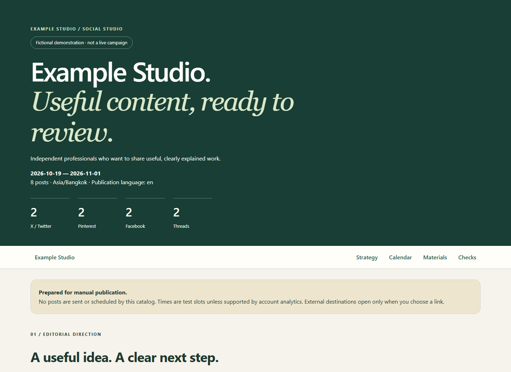

# Social Content Kit

A reusable agent skill for turning a website into a complete social campaign: researched topics, platform-specific copy, finished images, alt text, checked links, a publication calendar, and an offline HTML catalog.

Built for small businesses, independent creators, SaaS products, service businesses, and editorial sites. The site, audience, goal, language, date range, timezone, networks, cadence, and creative direction are configurable.

**All documentation and the catalog interface are English. Your posts can be in any requested language.**

**[Open the live demo catalog](https://gluberth.github.io/social-content-kit/demo/)** — no download or installation required. [Project homepage](https://gluberth.github.io/social-content-kit/).



## What you get

- A skill that researches the real project before making claims.
- A practical strategy with both **what to say** and **what to show**.
- A folder per platform and post, containing copy, image, alt text, link, sources, and notes.
- Purpose-composed 2:3 Pinterest images with separate title/description/link fields.
- A searchable, filterable English `index.html` with copy buttons and downloads.
- Local and UTC calendars, per-post UTM support, and a blank results tracker.
- Portable Python helpers for packaging, image/text/date checks, and optional public-link verification.
- A fictional eight-post demo and meaningful automated regression checks.

It prepares materials locally. It does not connect to social accounts, publish, schedule, buy ads, or modify the source website. Those actions need a separate request and an appropriate tool.

## Install the skill

Clone this repository into your personal Codex skills directory, in a folder named `social-content-kit`:

**macOS / Linux**

```sh
git clone https://github.com/gluberTH/social-content-kit.git ~/.codex/skills/social-content-kit
```

**Windows PowerShell**

```powershell
git clone https://github.com/gluberTH/social-content-kit.git "$env:USERPROFILE\.codex\skills\social-content-kit"
```

If you use a custom `CODEX_HOME`, use its `skills` directory instead. You can also download the repository ZIP and put the extracted folder there. The installed folder must contain `SKILL.md` directly. Do not overwrite an existing custom skill without reviewing it. Start a new chat if the skill is not yet listed.

Other agent environments can use `SKILL.md` as their entrypoint if they support this convention; otherwise provide its instructions and resource folder explicitly. Tool availability differs by environment.

## Use it

```text
Use $social-content-kit for https://your-site.example.
Audience: independent rental owners with 1-10 properties.
Goal: useful website visits and trial signups.
Start: 2027-03-08, for two weeks.
Timezone: Europe/London.
Platforms: X, Pinterest, Facebook, Threads.
Publication language: English.
Tone: calm, specific, practical.
Use the Social folder I provide as the quality reference.
Save everything locally in Social. Do not publish.
```

Or change the brief completely:

```text
Use $social-content-kit for my language-teaching website.
Audience: adults preparing for their first business trip.
Goal: newsletter subscriptions, not paid-product subscriptions.
Platforms: LinkedIn, Instagram, Pinterest.
Posts: Spanish. Documentation and catalog: English.
Prepare ten days of material, with three posts per platform.
Use my supplied brand colors and avoid unsupported learning promises.
```

A short conversation is enough; you do not have to hand-write JSON. The agent should gather the brief, research, draft, produce images, and use the helpers when useful.

## Run the included demo

Python 3.10+ is required for the helpers. Install the small image/timezone dependencies:

```sh
python -m pip install -r requirements.txt
python scripts/build_kit.py examples/campaign.json --output output/example
python scripts/validate_kit.py output/example
```

Open `output/example/index.html` in a browser. No server is required. You can also [view the hosted demo directly](https://gluberth.github.io/social-content-kit/demo/) or open the included [demo/index.html](demo/index.html) locally after cloning the repository.

The hosted version uses GitHub Pages, published from the root of the `main` branch. Updates to the committed static files are deployed automatically. `.nojekyll` keeps the catalog and its supporting files unchanged by a site generator.

The demo uses **Example Studio**, a fictional brand, and the reserved `example.com` domain. It demonstrates the package and interface, not campaign research or a real offer. Its simple workflow diagrams are documentation assets, not the intended visual style for every campaign.

The Python scripts do not write captions or generate images. Those are the agent's creative tasks. The scripts package finished material and check deterministic constraints. Image generation uses whatever authorized capability is available in the agent environment; no API credential is embedded in this project.

## Customize

Edit the input JSON or ask the agent to create one. [The data contract](references/data-contract.md) describes every field. Add any network by defining its label, format, text budgets, link behavior, and image ratio. The included four networks are examples, not a fixed limit.

Change `brand`, `audience`, `goals`, `language`, `start_date`, `duration_days`, `timezone`, `utm_campaign`, `strategy`, `platforms`, and `posts`. For visual customization, adapt `assets/catalog.css` and the campaign's original artwork. Keep text contrast and mobile controls usable.

For a site with few articles, the skill develops useful posts from verified product workflows, decisions, checklists, and honest limitations. It links to real pages; it does not invent a blog archive, testimonials, statistics, or customer outcomes.

## Validation and its limits

```sh
python scripts/validate_kit.py output/example --check-links
python -m unittest discover -s tests -v
```

The validator checks companion-file consistency, image decoding/size/hash, configured text budgets, Pin aspect ratio, local links, date/time conversion, and optional public HTTP links. It never loads private network destinations or sends account credentials. A server can block an automated check; the result is reported, not disguised as success.

Character budgets are configurable editorial constraints. Check current official platform specifications for the actual post type. The X helper is exact for ASCII-only copy and conservative for other Unicode; use official `twitter-text` if an exact complex-Unicode count is needed.

Visual inspection, factual review, relevance of the destination, and browser interaction remain necessary. A script cannot prove that a generated image is accurate or that a campaign will perform. Results start blank; UTM parameters alone do not create analytics or payment attribution.

Regenerating with `--overwrite` updates files owned by the prior build, preserves the results tracker and unrelated files, and keeps old removed-post folders. Use a new folder for a clean final version. See [the contract](references/data-contract.md) for details.

## Repository layout

```text
SKILL.md                 Agent entrypoint
agents/openai.yaml       Skill discovery metadata
references/              Brief, editorial rules, platform checks, JSON contract
scripts/                 Portable builder and validator
assets/                  English catalog CSS/JS and preview
examples/                Fictional campaign JSON and original diagram assets
demo/                    Prebuilt English catalog
tests/                   Behavioral regression tests
README.md                Installation and usage
LICENSE                  MIT
```

## Contributing

Keep the skill useful across brands and languages. Include a small reproducible example for script changes, run the tests, and visually review catalog changes at narrow and desktop widths. Do not contribute customer data, credentials, copied paid assets, unverified platform promises, or actual campaign analytics. See [CONTRIBUTING.md](CONTRIBUTING.md).

## License

MIT for this skill, code, documentation, and included original demo diagrams. User-provided source assets retain their own rights and permissions; using this skill does not relicense them.
